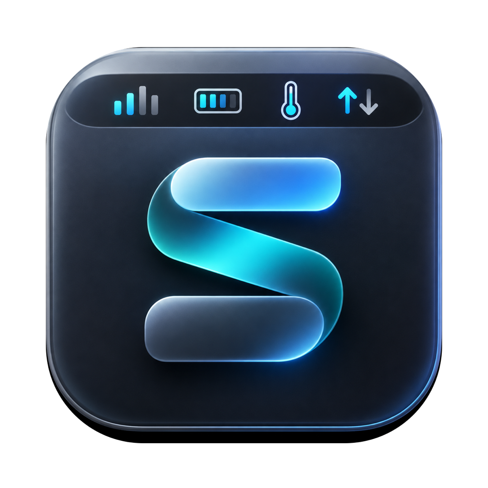

<p align="center">
  
</p>

# 系统监控 / SysBar

一个常驻 macOS 菜单栏的小工具，实时显示 CPU 温度、CPU 使用率、内存占用率、SSD 温度、网络速度。

A lightweight menu bar monitor for Apple Silicon Macs: CPU temperature & usage, memory, SSD temperature, and network throughput.


默认「双行数据」布局：上排是实时数值，下排是对应的参数简称；网络速度分两行显示，上排为上传 `↑`，下排为下载 `↓`。例如上排 `43% 86° 84% 53° ↑34K`、下排 `CPU TEMP RAM SSD ↓1.2M`。也可切换为单行「带标签」或「紧凑数字」。

点击菜单栏数值可查看：

- CPU 温度：最高核心温度，附 14 个 CPU 温度传感器明细（PMU tdie）
- CPU 使用率：总体 + 每个核心
- 内存占用：App 内存、常驻内存、压缩内存、空闲内存明细
- 硬盘温度：内置 SSD 的 NAND 传感器，附传感器明细
- 网络速度：实时下载/上传速度；各网卡的 IP、速率与累计流量
- 菜单栏显示：显示项开关、双行数据 / 带标签 / 紧凑数字、高对比底色
- 刷新间隔：1 / 2 / 5 秒
- 开机自动启动开关
- 诊断信息：温度来源、传感器数量、热状态、网络与设置状态，可一键复制
- 检查更新：从 GitHub Releases 检查新版本，直接下载并自动安装
- 退出

CPU 温度超过 90°C 显示橙色、超过 100°C 显示红色；SSD 温度超过 70°C 显示橙色、超过 80°C 显示红色；内存超过 90% 显示橙色、超过 95% 显示红色。

## 菜单栏显示与可读性

菜单中的「菜单栏显示」可以：

- 分别开关 CPU / 内存 / 硬盘温度 / 网络速度，至少保留一项
- 在三种布局之间切换：
  - 「双行数据」（默认）：上排动态数值，下排参数简称；网络速度上排为上传（`↑`），下排为下载（`↓`）
  - 「带标签」：`CPU 86°/43% · RAM 84% · SSD 53° · ↓1.2M↑34K`
  - 「紧凑数字」：`86°/43% 84% 53° ↓1.2M↑34K`
- 开关「高对比底色」：默认开启，为菜单栏文字加半透明深色底，浅色壁纸下也能看清

菜单栏文字统一使用白色，并带细描边和阴影，减少不同屏幕、壁纸下颜色和对比度不一致的问题。

## 检查更新

菜单中的「检查更新…」会请求 GitHub Releases 的最新版本，发现版本更高时可直接下载 DMG 并自动安装，完成后应用会重新启动。

- 下载后会把安装包中的应用与当前版本比对，并校验 Bundle ID、版本号和代码签名
- 自动安装仅支持位于 `/Applications` 的版本；从磁盘映像直接运行时请手动拖入“应用程序”
- 更新过程只访问 GitHub API 和 GitHub 的发布包地址，不上传任何数据

也可以在终端检查版本：

```bash
"/Applications/系统监控.app/Contents/MacOS/SysBar" --check-update
```

## 安装位置

- 应用：`/Applications/系统监控.app`
- 登录自启：`~/Library/LaunchAgents/com.denny.sysbar.plist`

菜单中的「开机自动启动」开关与上述 LaunchAgent 文件同步，切换后在下次登录时生效。

## 兼容性

- **架构**：arm64，适用于所有 Apple Silicon Mac（M1 / M2 / M3 / M4 及后续）；不支持 Intel Mac。
- **系统**：macOS 14 Sonoma 及以上（二进制最低部署版本 14.0）。
- **CPU 使用率、内存、网络**：与机型无关，所有 Apple Silicon Mac 可用。
- **CPU 温度**：优先读取 IOHID 的 `PMU tdie` 传感器；没有时按 `CPU / SOC / PACC / EACC / CORE / DIE` 规则使用备用传感器。不同机型的传感器命名可能不同，仍不可用时显示 `--°`，诊断信息会给出原因。
- **硬盘温度**：仅内置 SSD，且需要机型暴露 `NAND / SSD / NVMe` 温度传感器；外接硬盘不支持。
- 窄菜单栏或刘海屏机型，可通过「菜单栏显示」隐藏部分指标或切换紧凑数字。
- 目前仅在 M4 Mac mini（macOS 27）上实测；其他 Apple Silicon 机型未逐台验证。

## 分发与签名

- 当前为 ad-hoc 签名，未经过 Apple 公证。复制到其他 Mac 后首次打开可能被 Gatekeeper 拦截：右键「打开」，或在「系统设置 → 隐私与安全性」中选择「仍要打开」。
- 仓库不包含 `.app`、`.dmg` 等构建产物；请按下面的步骤从源码构建。
- 从磁盘映像直接运行时无法设置开机启动，请先拖入 `/Applications`。

## 构建与安装

需要 macOS 14+、Xcode Command Line Tools，以及 Apple Silicon Mac（构建目标为 `arm64-apple-macos14.0`）：

```bash
./test.sh    # 传感器分类/兜底规则测试
./build.sh
```

产物在 `build/系统监控.app`。安装时：

```bash
ditto "build/系统监控.app" "/Applications/系统监控.app"
```

## 隐私

除手动「检查更新」会访问 GitHub API 并下载发布包外，本应用不联网、不上传数据、不包含遥测；CPU、内存、温度、网络等指标均在本机读取。检查更新不会发送设备信息或使用数据。

## 数据口径

- **CPU 温度**：优先读取 IOHID 的 `PMU tdie` 组并取最高核心温度；没有主传感器时，按 `CPU / SOC / PACC / EACC / CORE / DIE` 命名规则使用备用传感器，并在菜单和诊断中标注来源。无需 sudo，也不依赖第三方组件。
- **CPU 使用率**：`host_processor_info` 两次采样间的 tick 增量，按核心与总体计算。
- **内存占用**：`host_statistics64`，`已用 = App 内存 + 常驻内存 + 压缩内存`，与活动监视器的「已用内存」口径接近。
- **SSD 温度**：读取 IOHID 中内置 SSD 的 `NAND` 温度传感器；外接硬盘通常不通过该接口提供温度。
- **网络速度**：通过 `NET_RT_IFLIST2` 读取系统 64 位收发计数器，统计所有物理网卡（`en*`），按采样间隔计算速率；VPN、回环等虚拟接口不计入，避免重复统计。

温度使用私有 IOHID 接口，若系统大版本升级后不可用，菜单会显示 `--°`，并在温度子菜单和「诊断信息」里给出原因和系统热状态。可用以下命令检查采集是否正常：

```bash
"/Applications/系统监控.app/Contents/MacOS/SysBar" --dump
```

诊断信息包含应用运行时间（不是系统开机时间）、温度来源与传感器数量、系统热状态、网卡状态和当前菜单栏设置。若温度不可用，可先运行上面的命令并把输出发给维护者。

## 项目结构

- `Sources/main.swift`：菜单栏、交互、诊断与偏好设置
- `Sources/Samplers.swift`：CPU 使用率与内存采样
- `Sources/TemperatureReader.swift`：IOHID 温度读取与备用来源
- `Sources/SensorClassifier.swift`：温度传感器分类与兜底规则
- `Sources/NetworkSampler.swift`：网卡计数、速率与 IP
- `Sources/Version.swift`：版本号解析与比较
- `Sources/Updater.swift`：GitHub Release 检查、下载、校验与自动安装
- `Assets/AppIcon.icns`：应用图标
- `Tests/main.swift` + `test.sh`：传感器分类与版本比较测试

## 发布新版本

1. 更新 `Info.plist` 中的 `CFBundleShortVersionString` 和 `CFBundleVersion`。
2. 运行 `./test.sh && ./build.sh`，将 `.app` 打包为 DMG。
3. 以 `vX.Y` 为标签创建 GitHub Release，并上传文件名包含 `AppleSilicon` 的 `.dmg` 资产。
4. 已安装旧版本的用户即可在菜单中「检查更新…」检测到该版本。

## 贡献

欢迎提交 Issue 或 PR。修改采样或传感器相关逻辑时，请先运行 `./test.sh`；涉及温度命名规则的改动，建议附上目标机型的传感器名称和 `--dump` 输出。

## License

本项目使用 [MIT License](LICENSE) 开源，Copyright (c) 2026 maowei-cmd。

## 卸载

1. 从菜单中退出「系统监控」。
2. 删除 `/Applications/系统监控.app`。
3. 删除 `~/Library/LaunchAgents/com.denny.sysbar.plist`。
